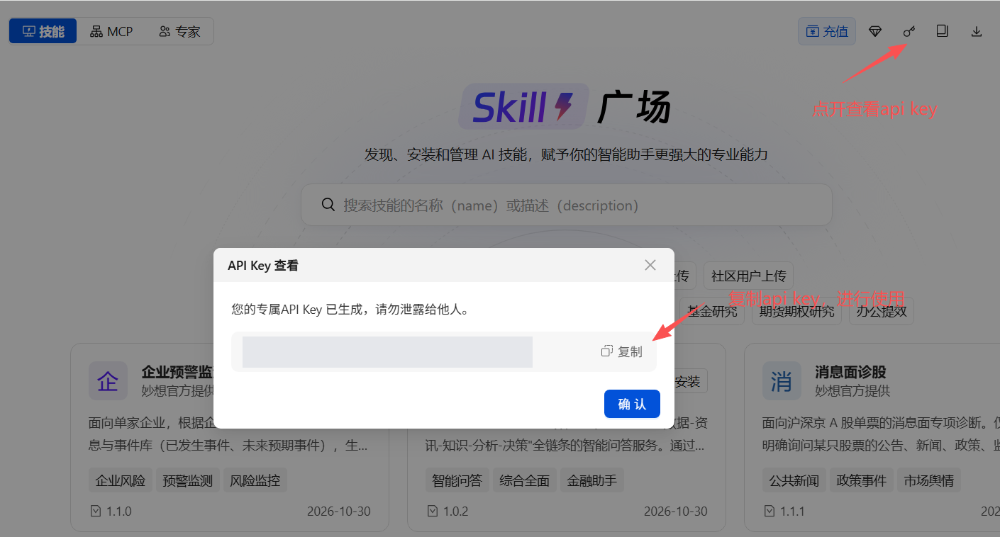

# EastmoneySkills · Eastmoney Miaoxiang Financial Skills

[简体中文](./README.md) · **English**

[](#-skill-catalog)
[](#-skill-catalog)
[](https://github.com/ai-eastmoney/EastmoneySkills/stargazers)

**Financial data access and professional research workflows for AI agents.**

Built around Eastmoney financial data, Choice data capabilities, and Miaoxiang research services, this collection provides **47 skills across 10 categories**. It covers equities, funds, ETFs, bonds, enterprises, industries, futures, macroeconomics and policy, research report review, and programmatic data retrieval.

Choose a skill for your task, describe the request in natural language, and produce data tables, analysis, or research documents through the relevant workflow.

🌐 **Official website: [Eastmoney Miaoxiang Skills](https://ai.eastmoney.com/skills)**

🔌 **Miaoxiang MCP: [Capabilities and connection guide](https://github.com/ai-eastmoney/EastmoneyMCP)**


## 🧭 Overview

A skill is a reusable task package. Its `SKILL.md` defines when to use it, the analytical framework, execution steps, and deliverable requirements. Scripts, references, and templates are included where needed.

| Capability | Tasks | Typical deliverables |
| --- | --- | --- |
| Data and retrieval | Look up known instruments, retrieve information, screen candidates | Data tables, search results, screening lists |
| Analysis and research | Explain fundamentals, price changes, industry drivers, and risks | Focused analysis, comprehensive assessments, detailed research |
| Reports and review | Document research, verify data, and refresh existing reports | Markdown, HTML, Excel, Word, or PDF |

Skills organize tasks; MCP exposes tools to the client; APIs and SDKs provide the underlying services and data. Connections and permissions vary by skill. See [Services and dependencies](#-services-and-dependencies).

This README is available in English. Skill instructions and source materials may be in Chinese; an English README does not imply that every service or workflow has been tested in English.

## 🚀 Quick start

### 1. Download and install with npx

Use an AI client that supports skills, with Node.js **22.20 or later** and npm. Install the capabilities relevant to your task:

```bash
npx skills add ai-eastmoney/EastmoneySkills --skill mx-finance-data stock-diagnosis
```

Follow the installer's prompts to select a client and installation scope. Read each skill's authorization and dependency instructions, then connect the required services. For example:

```text
Retrieve Kweichow Moutai's latest reported revenue and net profit.
Include the reporting period and return a data table.
```

To browse available skills first:

```bash
npx skills add ai-eastmoney/EastmoneySkills --list
```

These commands use [Skills CLI](https://github.com/vercel-labs/skills).

### 2. Get started with your agent

Send this request to an agent that can install skills, execute commands, or download files:

```text
Install the skills for me from:
https://github.com/ai-eastmoney/EastmoneySkills
```

The agent can help download and install skills for your client environment. To install only selected capabilities, include their names, such as `mx-finance-data` and `stock-diagnosis`.

This approach still requires the agent to access the repository. If GitHub or npm is unreachable, ask the agent to install from a previously downloaded complete local directory. Configure data services and authorization as required by the selected skills after installation.

## 🤖 Supported agents

Skills CLI supports installation to the following clients, according to its [agent support list](https://github.com/vercel-labs/skills/blob/main/docs/agents.md). These are installation targets; they have not all been tested with every financial workflow in this repository.

| Agent / client | Installation flag | Setup |
| --- | --- | --- |
| Claude Code | `-a claude-code` | Install the full skill and configure required services and MCP |
| OpenAI Codex | `-a codex` | Install the full skill and configure required services and MCP |
| Cursor | `-a cursor` | Use a version that supports skills and configure the required tools |
| OpenClaw | `-a openclaw` | Configure script execution and service connections |
| Gemini CLI | `-a gemini-cli` | Configure required tools and runtime dependencies |
| Hermes Agent | `-a hermes-agent` | Configure required tools and runtime dependencies |
| OpenCode | `-a opencode` | Configure required tools and runtime dependencies |
| Windsurf | `-a windsurf` | Use a version that supports skills and configure the required tools |

For example, target Claude Code or Codex explicitly:

```bash
npx skills add ai-eastmoney/EastmoneySkills --skill stock-diagnosis -a claude-code
npx skills add ai-eastmoney/EastmoneySkills --skill stock-diagnosis -a codex
```

Full workflows require a client that can read supporting resources, run the required scripts or call the specified tools, and access the necessary data. Tool names, service setup, and available outputs depend on the selected skill and client environment.

## 📚 Skill catalog

All skills are stored directly under `skills/`. Categories provide navigation in this README.

| Category | Count | Main tasks |
| --- | ---: | --- |
| 🧰 [Core financial tools](#core-financial-tools) | 8 | Data, information search, Q&A, screening, and watchlists |
| 📈 [Equity research](#equity-research) | 12 | Diagnosis, focused analysis, price attribution, and company reports |
| 🔎 [Industries and market themes](#industries-and-market-themes) | 6 | Industries, sectors, thematic research, monitoring, and trending topics |
| 📊 [Funds and ETFs](#funds-and-etfs) | 6 | Fund analysis, deep research, manager research, and holdings pressure |
| 📑 [Bond research](#bond-research) | 7 | Individual bonds, spreads, and regional debt resolution |
| 🌐 [Markets and policy](#markets-and-policy) | 2 | Macro liquidity and policy meeting comparisons |
| 🛡️ [Enterprises and risk](#enterprises-and-risk) | 2 | Entity research, risk, and news monitoring |
| ⚖️ [Futures research](#futures-research) | 1 | Individual futures contract research |
| 📝 [Research report workflows](#research-report-workflows) | 2 | Working papers, forecast review, and report reconstruction |
| 💻 [Quantitative tools](#quantitative-tools) | 1 | Choice API selection and programmatic data retrieval |
| **Total** | **47** | |

### Core financial tools

Queries retrieve data for known instruments; screening finds instruments that match criteria; watchlist tools manage your own lists. MQL provides reusable data retrieval for research workflows.

| Skill | Purpose |
| --- | --- |
| [Financial data queries · `mx-finance-data`](./skills/mx-finance-data/) | Query prices, valuations, financials, technical indicators, and capital flows in natural language for A-share, Hong Kong, and US stocks, funds, bonds, indices, and enterprises; supports individual and batch queries, with raw data tables in Excel and display tables in Markdown |
| [Financial information search · `mx-finance-search`](./skills/mx-finance-search/) | Search announcements, reports, news, and policy for a specified subject |
| [Macro data queries · `mx-macro-data`](./skills/mx-macro-data/) | Retrieve economic, price, monetary, fiscal, trade, and industry data with CSV output and data notes |
| [Private knowledge base search · `mx-personal-kb-search`](./skills/mx-personal-kb-search/) | Search Miaoxiang knowledge bases explicitly selected by the user |
| [Financial assistant · `mx-financial-assistant`](./skills/mx-financial-assistant/) | Answer financial knowledge, data, information, and analysis questions |
| [Instrument screening · `mx-stocks-screener`](./skills/mx-stocks-screener/) | Screen or rank stocks, funds, ETFs, convertible bonds, domestic futures, sectors, and other supported instruments, with CSV output and data notes |
| [Watchlist management · `mx-self-select`](./skills/mx-self-select/) | Query Choice and Eastmoney App watchlists; adding and removing securities is supported only for A-share, Hong Kong, and US stocks in Choice watchlists |
| [Standard MQL queries · `mql-query`](./skills/mql-query/) | Provide query conventions, syntax constraints, templates, and MQL execution for research skills |

### Equity research

#### Comprehensive and focused analysis

The following six skills target a single Shanghai, Shenzhen, or Beijing A-share stock. Their scope does not imply support for Hong Kong or US stocks or batch analysis.

| Skill | Purpose |
| --- | --- |
| [Stock diagnosis · `stock-diagnosis`](./skills/stock-diagnosis/) | Provide an overall assessment of a single A-share stock |
| [Fundamental analysis · `stock-fundamental-analysis`](./skills/stock-fundamental-analysis/) | Analyze financial quality, earnings growth, operations, and valuation |
| [Technical analysis · `stock-technical-analysis`](./skills/stock-technical-analysis/) | Analyze trends, price and volume, candlesticks, indicators, support, and resistance |
| [Capital flow analysis · `stock-capital-analysis`](./skills/stock-capital-analysis/) | Analyze fund flows, trading activity, and shareholding dynamics |
| [News analysis · `stock-news-analysis`](./skills/stock-news-analysis/) | Assess potential effects of announcements, news, policy, and events |
| [Institutional views · `stock-institutional-opinion`](./skills/stock-institutional-opinion/) | Summarize ratings, targets, forecasts, and institutional consensus or disagreement |

#### Price moves and unusual activity

| Skill | Purpose |
| --- | --- |
| [Price movement analysis · `stock-price-movement-analysis`](./skills/stock-price-movement-analysis/) | Explain a specified rise or fall in a single A-share stock within the past month |
| [Price anomaly review · `stock-price-anomaly-analysis`](./skills/stock-price-anomaly-analysis/) | Produce price-move rankings or a single-stock review; defaults to A-shares and defines workflows for Hong Kong, US, and other markets, subject to available data tools |

#### Company reports and comparisons

| Skill | Purpose |
| --- | --- |
| [Company deep research · `stock-deep-research`](./skills/stock-deep-research/) | Produce detailed listed-company research and a one-page report |
| [Initiation or deep-dive report · `initiation-of-coverage-or-deep-dive`](./skills/initiation-of-coverage-or-deep-dive/) | Generate an initiation-of-coverage or company deep-dive report through a service API |
| [Earnings review · `stock-earnings-review`](./skills/stock-earnings-review/) | Analyze quarterly, half-year, and annual reports and earnings performance |
| [Comparable company analysis · `comparable-company-analysis`](./skills/comparable-company-analysis/) | Compare A-share peers' operations, financials, and valuation in an Excel report |

### Industries and market themes

| Skill | Purpose |
| --- | --- |
| [Industry deep research · `industry-deep-research`](./skills/industry-deep-research/) | Research industries, market themes, and industry-related equity indices |
| [Industry research report · `industry-research-report`](./skills/industry-research-report/) | Generate a report for a specified industry through a service API |
| [Industry and sector analysis · `industry-sector-analysis`](./skills/industry-sector-analysis/) | Analyze A-share industries and thematic sectors, business conditions, value chains, and drivers |
| [Industry and stock tracking · `industry-stock-tracker`](./skills/industry-stock-tracker/) | Generate daily, weekly, monthly, or recent-development reports |
| [Thematic research · `topic-research-report`](./skills/topic-research-report/) | Research cross-industry policy, events, and trends |
| [Market hotspot discovery · `stock-market-hotspot-discovery`](./skills/stock-market-hotspot-discovery/) | Discover trending A-share market news, stocks, and themes |

### Funds and ETFs

| Skill | Purpose |
| --- | --- |
| [Fund diagnosis · `fund-diagnosis`](./skills/fund-diagnosis/) | Assess a single public fund's returns, risk, and considerations for holders |
| [Fund research report · `fund-research`](./skills/fund-research/) | Generate a detailed fund report and Markdown working papers through a service API |
| [Fund deep research · `fund-deep-research`](./skills/fund-deep-research/) | Produce detailed research and a one-page report for a single non-ETF public fund traded off-exchange |
| [Fund manager research · `fund-manager-research`](./skills/fund-manager-research/) | Research a single manager's career, investment style, and performance |
| [ETF deep research · `etf-deep-research`](./skills/etf-deep-research/) | Analyze a single ETF's size, liquidity, performance, risk, and holdings |
| [Top holdings pressure insight · `top-holdings-pressure-insight`](./skills/top-holdings-pressure-insight/) | Assess potential buying and selling pressure in major fund holdings across short and long horizons |

### Bond research

| Skill | Purpose |
| --- | --- |
| [Credit bond research · `credit-bond-deep-research`](./skills/credit-bond-deep-research/) | Analyze a single credit bond's creditworthiness, financials, spreads, and risks |
| [Convertible bond research · `convertible-bond-deep-research`](./skills/convertible-bond-deep-research/) | Analyze valuation, bond floor, contractual terms, and underlying-stock linkage |
| [Local government bond research · `government-bond-deep-research`](./skills/government-bond-deep-research/) | Analyze issuance, valuation, regional finances, and debt for a single local government bond |
| [New interest-rate bond research · `primary-bond-deep-research`](./skills/primary-bond-deep-research/) | Analyze a single newly issued interest-rate bond's pricing, post-listing liquidity, and prospects for becoming a benchmark bond |
| [On-the-run bond research · `on-the-run-bond-deep-research`](./skills/on-the-run-bond-deep-research/) | Analyze benchmark bond yields, liquidity, supply, and institutional activity |
| [Spread analysis · `credit-spread-deep-research`](./skills/credit-spread-deep-research/) | Analyze spreads by instrument, tenor, rating, credit, taxation, and liquidity |
| [Local government debt analysis · `local-government-debt-analysis`](./skills/local-government-debt-analysis/) | Research a region's economy, public finances, debt burden, and debt resolution progress |

### Markets and policy

| Skill | Purpose |
| --- | --- |
| [Macro liquidity research · `market-liquidity-deep-research`](./skills/market-liquidity-deep-research/) | Analyze central bank operations, interbank liquidity, and quarter-end funding conditions |
| [Policy meeting comparison · `meeting-minutes-comparison`](./skills/meeting-minutes-comparison/) | Retrieve source text, obtain user confirmation of meetings and dimensions, compare them with the model, and generate a Word document using the script |

### Enterprises and risk

Enterprise research supports entity due diligence and extends beyond listed equities.

| Skill | Purpose |
| --- | --- |
| [Enterprise deep research · `enterprise-deep-research`](./skills/enterprise-deep-research/) | Analyze governance, operations, financials, debt servicing, credit, and legal risks |
| [Enterprise alert monitoring · `enterprise-alert-monitoring`](./skills/enterprise-alert-monitoring/) | Track public sentiment, key events, related entities, and risk propagation |

### Futures research

| Skill | Purpose |
| --- | --- |
| [Futures contract research · `futures-deep-research`](./skills/futures-deep-research/) | Analyze volume, open interest, basis, term structure, inventory, and supply and demand for a single contract |

### Research report workflows

| Skill | Purpose |
| --- | --- |
| [Research report review · `research-report-review`](./skills/research-report-review/) | Extract tables and charts, verify data, build refreshable working papers, and review forecasts |
| [Research report reconstruction · `sellside-research-refresh-with-excel`](./skills/sellside-research-refresh-with-excel/) | Defines a workflow for generating a new report, Excel working papers, and evaluation results using an existing framework; full execution is currently blocked by missing required bundles |

### Quantitative tools

| Skill | Purpose |
| --- | --- |
| [Choice API data retrieval · `choice-quantapi-skill`](./skills/choice-quantapi-skill/) | Find EMQuantAPI documentation, select endpoints, and generate Python data retrieval code |

The “quantitative API” label follows Choice product terminology. This skill primarily supports programmatic data access and data preparation for strategy research. It does not include a standalone trading or backtesting engine.

## ⚙️ Detailed installation guide

### Choose the installation scope

The following commands use [Skills CLI](https://github.com/vercel-labs/skills), requiring Node.js 22.20 or later and npm. The first `npx` invocation may prompt you to download the tool.

List available skills:

```bash
npx skills add ai-eastmoney/EastmoneySkills --list
```

Install one skill in the current project:

```bash
npx skills add ai-eastmoney/EastmoneySkills --skill stock-diagnosis
```

Install several skills together:

```bash
npx skills add ai-eastmoney/EastmoneySkills --skill mx-finance-data mx-finance-search stock-diagnosis
```

Installation defaults to project scope. Add `-g` for global reuse across projects:

```bash
npx skills add ai-eastmoney/EastmoneySkills --skill stock-diagnosis -g
```

Select installation targets when prompted. Full workflow compatibility depends on the client's skill loading, script runtime, and tool connections; successful installation alone does not verify execution.

### Install from a local checkout

```bash
git clone https://github.com/ai-eastmoney/EastmoneySkills.git
cd EastmoneySkills
npx skills add . --list
npx skills add . --skill stock-diagnosis
```

For manual installation, follow your client's instructions and copy the complete skill directory to the required location. Keep `SKILL.md` and all supporting resources together, then reload or restart the client.

### Describe your research task

After installation, configure authorization, MCP, or the SDK as required by the skill. Example requests:

```text
Retrieve the latest reported revenue and net profit for Kweichow Moutai
and Wuliangye. Return a complete data table.

Analyze current capital flows for CATL and state the data timestamp.

Analyze E Fund Blue Chip Selected Mixed (005827) and produce a one-page
deep research report for this off-exchange fund.

Compare the economic policy language of two Politburo meetings,
with citations to the original sources.

Extract the charts and data from this research report, verify the
definitions, and build Excel working papers.
```

Specify the **subject, time range, analytical focus, and deliverable**. For example: “Review this company's latest financial report, focusing on earnings quality and cash flow, and return a Markdown commentary with sources.” For single-instrument research, focus on one instrument per request.

## 🔑 Services and dependencies

Running a skill requires the relevant data permissions, service connections, and software environment. Installing a skill and authorizing its data services are separate steps.

| Capability | Requirements to confirm |
| --- | --- |
| Miaoxiang API queries, diagnosis, and reports | Service access and authentication following the skill's instructions; some workflows use `EM_API_KEY` |
| MQL and dependent research workflows | Connected MQL MCP, required query tools, and data permissions |
| Announcements, news, and report search | The text retrieval service or MCP specified by the skill |
| Choice API data retrieval | Python, a working EMQuantAPI SDK, an account, and endpoint data permissions |
| Research report review and reconstruction | An accessible `layoutV2` PDF parsing gateway and valid `EM_API_KEY`; verify deployment placeholders or `EM_BASE_URL` configuration. Refreshing `=mql()` formulas in Excel also requires a working Choice Excel add-in and permissions |
| HTML, Excel, Word, and PDF outputs | Script dependencies and document generation or rendering tools specified by the skill |

Official entry points: [Miaoxiang Skills website](https://ai.eastmoney.com/skills) · [Eastmoney Miaoxiang chat](https://ai.eastmoney.com/chat). Read the selected skill for authorization steps, environment variables, tool names, and dependency versions. Credentials and permissions may be managed separately for different services.

### Get your EM_API_KEY

Visit the [Eastmoney Miaoxiang Skills website](https://ai.eastmoney.com/skills) and follow the page instructions to obtain an API key. Set it as the `EM_API_KEY` environment variable before running scripts that require it.

1. Sign in and click the key icon in the upper-right corner to open the API key dialog.
2. Click “复制” (Copy) to copy your API key and configure it locally.



Keep keys in your local environment or the service's designated credential storage. Do not commit them to GitHub or include them in Issues.

For skills supporting QR authorization, follow the built-in process. Scripts requiring `EM_API_KEY` need that environment variable set before execution. This repository does not include usable keys; do not insert personal keys into scripts, examples, or reference documents.

## 💬 FAQ

### Are all markets and output formats supported?

No. Some diagnosis skills support only A-shares; one-page research typically covers a single instrument. Output formats vary between Markdown, HTML, Excel, Word, and PDF. Check each skill's supported scope.

### Why does an installed skill fail to run?

Check service authorization, visible MCP tools, data permissions, and script dependencies first. Copying only `SKILL.md` may omit required scripts and templates; install the complete directory.

### Do README categories affect installation?

Categories are for navigation. Every skill is under `skills/` and installs by its directory name. Changing the display category does not change the installation name.

## 🗂️ Repository structure

```text
EastmoneySkills/
├── README.md
├── README.en.md
└── skills/
    ├── mx-finance-data/
    ├── stock-diagnosis/
    ├── stock-deep-research/
    ├── fund-deep-research/
    └── …
```

Each skill contains `SKILL.md` and may include `scripts/`, `references/`, `reference/`, `assets/`, or example files. Preserve the complete directory when installing, copying, or updating.

## 🤝 Maintenance and feedback

Report problems or request capabilities through [Issues](https://github.com/ai-eastmoney/EastmoneySkills/issues). Include:

- Skill name and version.
- Client, operating system, and relevant runtime details.
- A reproducible task description, actual result, and expected result.
- Redacted errors or necessary screenshots.

Maintenance changes should update skill descriptions, versions, dependencies, and README navigation, and check directory links, counts, and affected workflows. Keep credentials, private materials, and unauthorized data out of feedback and contributions.

## 📄 Rights and usage

Copyright in this repository's contents belongs to Eastmoney. Installation and use are subject to each skill's license terms and the applicable service terms. Copying, redistribution, or commercial use beyond those permissions requires prior authorization from Eastmoney.

Eastmoney, Miaoxiang, Choice, and other product names and trademarks belong to their respective owners. Access to and use of financial data, research reports, announcements, and retrieved materials remain subject to the source providers' authorization terms.

Research outputs assist information organization and analysis and do not constitute investment advice. Verify data timestamps, sources, and calculation definitions before making decisions.
